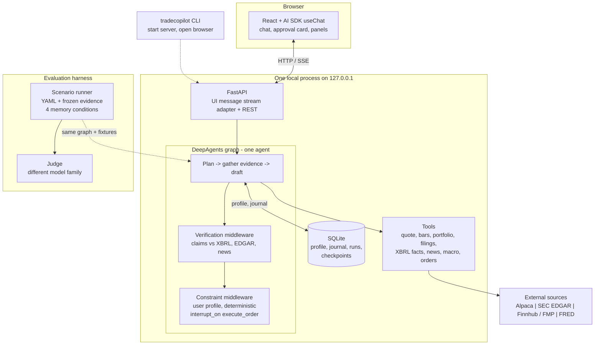

# TradeCopilot System Design

## 1. Overview

Single-user, local, on-demand co-pilot with no authentication. One Python process
serves both the API and the built web UI. A CLI starts it and opens the browser.
Ctrl-C stops the process.



### Tech stack

| Layer | Choice | Rationale |
| --- | --- | --- |
| Agent | DeepAgents (LangGraph) | planning, todo tracking, middleware checks, interrupt_on approval, provider:model strings |
| Backend | FastAPI + uvicorn | one process serves the API and the built SPA; native SSE |
| Frontend | React, Vite, TypeScript | static SPA build |
| AI SDK | Vercel AI SDK | useChat and the UI message stream over SSE |
| UI kit | shadcn/ui, AI Elements | ready-made chat, tool, reasoning, and message parts |
| Storage | SQLite | one local user; profile, journal, traces, checkpoints |
| Data | Alpaca, SEC EDGAR, Finnhub/FMP, FRED | free tiers |
| Evaluation | Python harness with a separate LLM judge | frozen fixtures, deterministic runs |
| Tooling | uv, npm | reproducible setup and builds |

## 2. Agent

`create_deep_agent` from the deepagents package. One agent. The auto-added
general-purpose subagent and the filesystem tools are optional.

State: messages, todos, evidence records, draft recommendation, verification result,
pending ticket, execution mode. Custom fields are declared with `state_schema`.

Middleware (passed via `middleware=`):

- Memory middleware: injects the active memory condition into the system prompt per
  request.
- Verification check: extract the main claims from the draft recommendation as
  `{text, type, value, period, evidence_hint}`, where type is numeric, filing, news,
  or opinion. Numeric claims are matched deterministically against EDGAR XBRL facts on
  tag, period, and unit with a tolerance. Filing claims are checked against EDGAR,
  news claims against the evidence set. Verdicts are supported, contradicted, or
  unverifiable. Contradicted claims are removed from the user-facing recommendation
  and shown in the verdict panel. There is no automatic re-draft; verification runs
  once per response.
- Constraint check: deterministic validation of the order ticket against the user's
  profile. Hard blocks: position cap, sector exclusions, execution permissions, buying
  power, market hours. The check always uses the ground-truth structured profile, in
  every memory condition. The condition changes what the agent sees, not the safety
  boundary.

Plan/todo and summarization are built-in middleware.

Loop: plan -> gather evidence -> draft -> verify -> constrain -> interrupt or execute.

Approval uses DeepAgents `interrupt_on` for `execute_order` in manual mode. The
interrupt becomes an AI SDK `tool-approval-request` part; the ticket, rationale,
cited evidence, verification verdicts, and portfolio impact travel in the part's
approval descriptor. The client answers with `addToolApprovalResponse`, and the next
chat request resumes the graph. Resume accepts approve or reject with a reason.
Autonomous mode skips the interrupt only when preset permissions allow the order.

### Models

The agent model is passed to `create_deep_agent` as a `provider:model` string,
selected from an env-overridable role map:

```text
agent
judge
```

The judge runs inside the evaluation harness, outside the agent graph, and is
instantiated separately with the same `provider:model` convention. It must be a
different model family from the agent.

## 3. Data and tools

### Tools

| Tool | Source | Notes |
| --- | --- | --- |
| `get_quote`, `get_bars` | Alpaca | - |
| `get_portfolio`, `get_positions` | Alpaca | account state |
| `get_fundamentals` | FMP, Finnhub fallback | - |
| `get_filings` | SEC EDGAR | free, no key |
| `get_xbrl_fact` | SEC EDGAR companyfacts | primary source for numbers |
| `get_news` | Finnhub, FMP fallback | - |
| `get_social_sentiment` | social sentiment | fixture-backed only |
| `get_macro` | FRED | - |
| `propose_order` | - | builds a ticket, no side effect |
| `execute_order` | Alpaca | token or autonomous permission; every rejection logged |
| `update_preference` | memory | writes the profile; hard-constraint changes need confirmation |

Every tool returns a provenance record: source, published_at, fetched_at, payload,
stale, url. The agent decides whether evidence is fresh enough for the decision; there
are no fixed per-source thresholds. It may not ground a numerical claim or an order on
evidence it judges stale.

Tools are plain Python functions with type hints and docstrings, passed to
`create_deep_agent(tools=...)`, which converts them to model tools. A data source is
bound when the graph is constructed. The evaluation harness binds a fixture source
keyed by tool name and normalized arguments and replaying frozen JSON. The agent code
does not know which source it is talking to.

### Portfolio and outcomes

Portfolio time series comes from Alpaca account history. No reconstruction from
fills. Alpaca handles dividends and splits.

Decision outcomes are computed lazily on read from daily bars:

- entry price is the fill price, or the decision-time quote when not executed;
- horizon is the one stated in the recommendation;
- return is compared with SPY over the same window;
- rejected proposals get a counterfactual outcome.

In evaluation, outcomes and retrieval use only data dated before the scenario's as-of
date.

## 4. Memory

The memory subsystem is the project's research contribution.

### Structured profile memory

Stores durable user state as typed fields: risk band, position cap (percent of account
equity), sector exclusions, horizon, watchlist, source preferences, and execution
permissions. Sectors use the GICS taxonomy from the fundamentals provider. Permissions
are an autonomous flag and a maximum order notional. The profile is editable in
settings. Changing that affects hard constraints or execution require confirmation.
Buying power comes from Alpaca live and from scenario fixtures in evaluation.

### Episodic decision memory

Append-only; records each proposal, the evidence behind it, the user's action and
reason, and what happened afterwards. Structured as:

```text
id, created_at, tickers, side, qty, size_pct, thesis, evidence_ids,
status, user_action, rejection_reason, fill_price, fill_at, outcome_note
```

Status: proposed, approved, edited, rejected, deferred, filled, failed. Rows are
appended at proposal, at approval/rejection/edit, and at execution result. Never
rewritten.

Read path (full memory only): on a new request, retrieve entries overlapping the request
tickers or their sector within 90 days, capped at 10, ranked by ticker overlap then
recency. Inject a compact block with entry ids. All fields are visible to the agent,
including outcomes.

Preference promotion reads the same rows. Repeated rejection reasons, repeated size
edits, and repeated sector avoidance are written into the profile: low-impact
preferences automatically, and anything that changes hard constraints or execution
only after user confirmation.

### Working memory

Run-specific LangGraph state: intermediate findings, evidence references, draft, and
claim-check results.

### Memory conditions

| Condition | Contents |
| --- | --- |
| No memory | no persistent user memory |
| Prose profile memory | the profile as ordinary text |
| Structured profile memory | the profile as typed constraints and preferences, without the journal |
| Full memory | structured profile memory plus the relevant decision journal |

The condition is applied by one shared builder used by both the live app and the
evaluation runner:

```python
class MemoryConfig(BaseModel):
    condition: Literal["none", "prose", "structured", "full"]
    store: MemoryStore

def build_agent(config: MemoryConfig, source: DataSource, as_of: date | None) -> CompiledGraph:
    return create_deep_agent(
        model=AGENT_MODEL,
        tools=TOOLS,
        system_prompt=SYSTEM_PROMPT,
        middleware=[MemoryMiddleware(config), VerificationCheck(), ConstraintCheck()],
        checkpointer=...,
    )
```

`MemoryMiddleware` injects the memory block lazily at model-call time: it reads the
current request from state, retrieves journal entries when the condition is full, and
renders the block into the system prompt. Under no memory it is a no-op. Nothing is
baked in at construction, so one graph per condition serves every request.

Model, tools, instructions, and limits are identical across conditions. Only the
memory block and the seeded database differ. The app always passes full memory. The
runner is the only caller that passes the other three.

## 5. Interface

### Backend API and streaming

```text
POST /api/chat                 SSE, AI SDK UI message stream
GET  /api/portfolio
GET  /api/profile
PATCH /api/profile
GET  /api/journal
GET  /api/health
```

`POST /api/chat` takes the AI SDK request body `{thread_id?, messages}` and creates a
thread when no thread id is given; the thread id is returned in the stream as a
`data-thread` part. On a normal turn only the last user message is passed to the
graph, because the checkpointer already holds the conversation. On an approval turn
the last assistant message carries a tool part in `approval-responded` state and the
server resumes the interrupted graph with `Command(resume=...)`. There is no separate
approval endpoint.

The pending ticket lives in checkpointed graph state, not a table. The approval id is
the tool call id, and the ticket id is the idempotency key.

The stream adapter is the only code that knows the wire format. It is a faithful port
of the LangGraph path of the official `@ai-sdk/langchain` adapter: message, values,
custom, tool, reasoning, step, and interrupt translation, plus `UIMessage` to
LangChain message conversion. It is tested against the pinned AI SDK major version.
Domain events are sent as data parts:

- `data-verification`
- `data-todos`

Approval uses the AI SDK tool approval parts, not a data part.

### Frontend

The conversation is the main surface. A left panel has tabs for Portfolio, Profile,
and Journal. The approval card renders from the tool approval part; its descriptor
carries the ticket, rationale, evidence, verdicts, and portfolio impact.

## 6. Evaluation

### Harness

Scenarios are YAML files: instrument, as-of date, user profile, request, frozen
evidence, and acceptance criteria. Ten scenarios: six representative (two earnings, two
news, two portfolio adjustments) and four adversarial (two false claims, one constraint
temptation, one tool failure). Each run uses its own SQLite database and fixture source
seeded from the scenario, so runs and the live journal never mix. The as-of date is
passed to tools and to outcome computation. The runner calls the shared `build_agent`
once per condition. The constraint validator is called directly, so no execution
backend is needed.

The full system runs all ten; the memory comparison is a focused ablation on a
pre-selected subset covering constraint use, preference changes, and previous
decisions.

Recorded per run: task success and constraint adherence, verification quality,
recommendation quality (judge scores), consistency across conditions, and operational
performance (tokens, cost, latency).

### Judge

Evaluation only. It is never imported by the running system.

It sees the scenario request, the user context (always, including under no memory),
the frozen evidence catalog, and the proposal as the user would have seen it. It is
blind to the memory condition.

It returns structured JSON scoring evidence coverage, reasoning, risk disclosure,
profile fit, and actionability on a 1-5 scale, with cited evidence and a short
rationale. Temperature is 0. Invalid output is retried once, then recorded as
`judge_error`.

The same prompt, model, and version are recorded with every score. About 20 percent
of scored items get a human spot-check, and agreement is reported.

## 7. Persistence

SQLite tables:

- `profile`
- `journal`
- `runs` (trace: thread, phase, model, tokens, cost, latency)

LangGraph checkpointer in the same `data.db` file, one thread per conversation.
`AsyncSqliteSaver` owns its own tables. An interrupted thread resumes after restart.

## 8. Safety

- Paper trading is the default. Live trading requires an explicit opt-in flag and a
  per-order confirmation.
- The server binds to 127.0.0.1 only. Keys live in a local .env and never reach the
  browser.
- Hard constraints are enforced in code at the execution boundary, not by the prompt.
- Filesystem, shell, and arbitrary code tools are off by default.

## 9. Open items and optional additions

### Open

- Model providers and keys are chosen at setup.

### Optional

- Judge rubric calibration beyond the human spot-check.
- Langfuse. SQLite traces cover cost, latency, and per-phase metrics.
- Live trading.
- Tauri. The single-origin design means adding it later is a webview pointed at
  localhost plus the Python sidecar.
- Subagents.
- Live social sentiment feeds.
